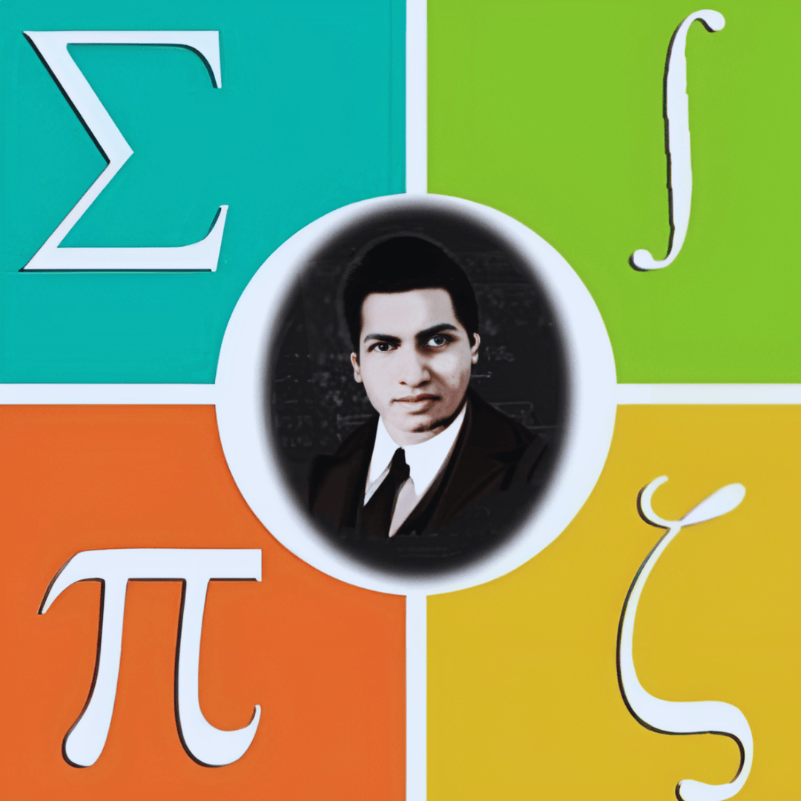

# RMC | Ramanujan Math Club

> "The Enigma of RMC" - A cinematic, premium web experience for the Ramanujan Math Club of CBIT.

 
*(Note: Replace with actual banner if available)*

## 🌌 Overview

This project is a complete reimplementation of the RMC official website, designed with a **"Math Noir"** aesthetic. It combines high-end visual effects, cinematic animations, and a mysterious, premium feel to represent the club's intellectual depth.

**Theme**: Enigma / Math Noir / Dark Academia + Cyberpunk
**Core Colors**: Teal (`#3ABCB3`), Lime (`#AFF44A`), Coral (`#E36951`), Orange (`#E8B237`) on Deep Black.

## ✨ Features

### 🏛️ Public Portal
-   **Cinematic Hero**: `SpotlightHero` with parallax effects and interactive "Logic Gate" navigation.
-   **Events Timeline**: "Holographic" event cards with 3D tilt and glitch effects.
-   **Visual Registry (Gallery)**: Masonry layout with parallax tilt and `MathBackground` integration.
-   **The Council (Team)**: Premium profile cards with gradient borders and glassmorphism.
-   **Establish Connection (Contact)**: a "Transmission" themed contact form with simulated uplink animations.

### 🛡️ Admin System
-   **Dual-Layer Auth**: Access for "President" (Super Admin) and "Event Admins".
-   **Dashboard**: Command center to manage events and view stats.
-   **Event Creation**: Form with date/time range support and auto-generated secure passwords for new events.
-   **Registration Management**: View and manage participants for specific events.

## 🛠️ Tech Stack

-   **Framework**: [Next.js 15+](https://nextjs.org/) (App Directory)
-   **Styling**: [Tailwind CSS](https://tailwindcss.com/) (v4 Alpha/Standard)
-   **Animations**: [Framer Motion](https://www.framer.com/motion/)
-   **Icons**: [Lucide React](https://lucide.dev/)
-   **Fonts**: `Cormorant Garamond` (Serif), `Montserrat` (Sans), `JetBrains Mono` (Code), `Cinzel` (Headers).

## 🚀 Getting Started

1.  **Clone the repository**:
    ```bash
    git clone https://github.com/Vishnuvardhanvemula/RMC.git
    cd RMC/Main
    ```

2.  **Install dependencies**:
    ```bash
    npm install
    # or
    yarn install
    ```

3.  **Run the development server**:
    ```bash
    npm run dev
    ```

4.  **Open the application**:
    Navigate to [http://localhost:3000](http://localhost:3000).

## 📂 Project Structure

-   `src/app`: App directory routes (Home, Events, Team, Admin, etc.)
-   `src/components`: Reusable UI components (`MathBackground`, `SpotlightCard`, `SectionTitle`).
-   `src/data`: Static data files (`upcomingEvents.js`).
-   `src/lib`: Utilities (`utils.js`).

## 🎨 Design System

We enforce a strict design consistency:
-   **Backgrounds**: Always use `<MathBackground />` for pages.
-   **Headers**: Use `<SectionTitle />`.
-   **Cards**: Use `<SpotlightCard />` or `<HolographicCard />`.
-   **Typography**: Serif for headings, Sans for body, Mono for accents.

## 🤝 Contribution

1.  Fork the repository.
2.  Create your feature branch (`git checkout -b feature/AmazingFeature`).
3.  Commit your changes (`git commit -m 'Add some AmazingFeature'`).
4.  Push to the branch (`git push origin feature/AmazingFeature`).
5.  Open a Pull Request.

---
*Est. 2018 | Ramanujan Math Club, CBIT*
